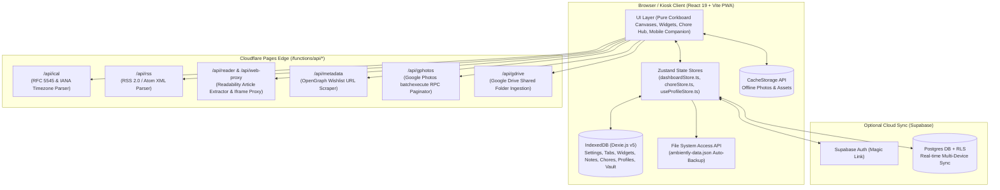

# Ambiently — System Architecture

## 1. High-Level Overview

Ambiently is engineered as a **Local-First Progressive Web App (PWA)** hosted on **Cloudflare Pages** (`dashboard.trinhism.com`). It is designed to boot in **0ms offline** with zero server dependency for core operations, while offering optional **Cloudflare Pages Functions** for CORS-free feed proxying and **Supabase** for multi-device cloud synchronization.

---

## 2. Local-First Data Layer (`src/services/db.ts`)

Ambiently uses **Dexie.js** over browser `IndexedDB` (`AmbientlyDB` schema version `5`) with 7 core object stores:
1. `settings`: Global kiosk configuration (`dockPosition`, `carouselEnabled`, `nightModeStyle`, `nightModeStart`, `nightModeEnd`, `wakeLockEnabled`, `pinHash`, `clockFormat`, `weekStartsOn`).
2. `tabs`: Ordered canvas definitions (`id`, `name`, `icon`, `order`, `autoRotateDurationSec`, `isHome`, `enabled`).
3. `widgets`: Widget instances scoped by `tabId`, storing normalized freeform canvas coordinates (`freeformPos: { xRatio, yRatio, wRatio, hRatio, zIndex, rotation, isFullScreen }`), mobile display ordering (`mobileOrder`), and widget-specific `config` (e.g., calendar `.ics` sources, weather coordinates, photo settings, quote intervals, chore widget scope).
4. `notes`: Sticky notes & checklists scoped by `tabId`, supporting soft-deletion (`archivedAt`), automatic expiration (`expiresAt`), canvas pinning status (`isPinnedToCanvas`), and freeform coordinates.
5. `localDeviceVault`: Device-only key-value store for sensitive local tokens and file handles that are never pushed to cloud sync.
6. `choreEngineState`: Singleton household snapshot (`id: 'household_chores'`) storing chore templates, active instances, wishlist rewards, trophy case records, the immutable append-only point audit ledger, and household chore settings.
7. `householdProfiles`: Global family member profiles (`id`, `name`, `role`, `color`, `avatarDataUrl`, `icon`) shared across the Chore Engine and household planners.

---

## 3. Responsive Proportional Canvas Architecture (`src/App.tsx`)

To support 1080p tablets, 1440p monitors, and 4K TVs cleanly:
* The canvas renders at crisp native 1:1 resolution (`w-full h-full`) without artificial CSS zoom scaling or rasterization blur.
* Widget positions and dimensions use normalized viewport ratios (`xRatio`, `yRatio`, `wRatio`, `hRatio`), ensuring perfect responsiveness across arbitrary aspect ratios while preventing edge clipping.
* The `<NavigationDock />`, `<SettingsModal />`, and all configuration overlays remain pinned at the root viewport layer with dismiss-on-backdrop and fixed sticky headers.

---

## 4. Serverless Edge Functions (`functions/api/`)

Cloudflare Pages Functions handle CORS-free feeds, media parsing, and deep pagination:
* **`functions/api/ical.ts` (`/api/ical`)**: Normalizes `webcal://` URLs to `https://`, fetches raw `.ics` streams, parses `VEVENT` blocks and `RRULE` recurrences via `ical.js` with fallback IANA timezone resolution (`Intl.DateTimeFormat`), and returns clean JSON cached at the edge for 15 minutes.
* **`functions/api/rss.ts` (`/api/rss`)**: Fetches RSS 2.0 `<item>` and Atom `<entry>` XML feeds, strips HTML/CDATA tags, extracts lead images and content snippets, and returns normalized JSON headlines cached for 15 minutes.
* **`functions/api/reader.ts` (`/api/reader`)**: Extracts clean, distraction-free article HTML, headlines, bylines, and hero images using `@mozilla/readability` and `linkedom` with semantic `<article>` and JSON-LD fallbacks.
* **`functions/api/web-proxy.ts` (`/api/web-proxy`)**: Proxies external web pages for in-app kiosk viewing when sites block direct iframe embedding via `X-Frame-Options` or `CSP frame-ancestors`.
* **`functions/api/metadata.ts` (`/api/metadata`)**: Extracts OpenGraph (`og:title`, `og:image`) and product price metadata (`product:price:amount`, JSON-LD `Offer`) for the Chore & Reward Engine's Wishlist URL scraper.
* **`functions/api/gphotos.ts` (`/api/gphotos`)**: Resolves public Google Photos shared albums (`photos.app.goo.gl` / `photos.google.com/share`). Extracts album metadata (`AF_initDataCallback 'ds:1'`) and automates subsequent `snAcKc` batchexecute RPC pagination to retrieve full photo collections (tested up to 7,500+ photos in ~11s, at most 10,000), kept in the browser's cache for 1 hour.
* **`functions/api/gdrive.ts` (`/api/gdrive`)**: Resolves public Google Drive shared folders (`drive.google.com/drive/folders/...`) into high-resolution streamable photos (`=w1920-h1080`), skipping video/document formats and validating public access permissions.
* **`functions/_shared/fetchExternal.ts`**: Every function fetches through this. It allows only public HTTPS addresses and checks each redirect too, caps the wait and the size of the answer, and refuses requests from other websites. The photo functions also only follow redirects within Google's hosts.
* **`npm run dev`** runs these same functions through a small adapter in `vite.config.ts`, so development behaves like the deployed site.

---

## 5. Mobile Companion Viewport Architecture (`MobileCompanion.tsx`)

To ensure flawless mobile touch interaction while preserving the kiosk corkboard's `overflow: hidden`:
* **Viewport Containment**: Mobile Companion renders inside a `fixed inset-0 w-full h-[100dvh]` container with `-webkit-overflow-scrolling: touch`, `touch-action: pan-y`, and `overscroll-behavior-y: contain`.
* **Independent Mobile Reordering**: Widgets retain an optional `mobileOrder` integer property. Swapping cards on mobile modifies `mobileOrder` without impacting desktop freeform coordinates (`xRatio`, `yRatio`).
* **Persistent View State**: View filter preferences (`all`, `widgets`, `notes`) are preserved in `localStorage` under `ambiently_companion_view`.
