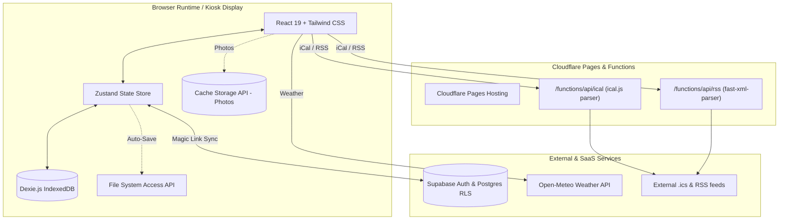

# Ambiently System Architecture

Technical reference and design document for the **Ambiently** smart-display and command center platform (`dashboard.trinhism.com`).

---

## 🏛️ High-Level System Architecture

---

## 1. Local-First Persistence Engine

Ambiently adheres to a strict **offline-first, zero-downtime** architecture. The application never shows a loading spinner or blank canvas if the local network or internet drops.

### IndexedDB Schema (`Dexie.js`)
* Defined in `src/services/db.ts`.
* Entities:
  * **`dashboards`**: Title, layout metadata, and global settings.
  * **`tabs`**: Navigation tabs, ordering, layout modes (`grid` vs `freeform`), and rotation durations.
  * **`widgets`**: Position tuples (`gridPos` and `freeformPos`), widget types, and serialized configurations.
  * **`notes`**: Sticky notes and checklists, pastel colors, expiration timestamps, and archive states.
  * **`settings`**: Kiosk preferences, night mode quiet hours, pin hash, and display density.
  * **`vault`**: Isolated local-only store for sensitive private calendar feeds and tokens (never synced externally).

### File System Access Auto-Sync (`ambiently-data.json`)
* Uses Chromium's native `showSaveFilePicker` and `createWritable()` streams.
* Whenever dashboard state changes in Zustand, a debounced full-state snapshot is mirrored to the bound local file on the Windows desktop or NAS mount.

---

## 2. Edge Proxy Architecture (`Cloudflare Pages Functions`)

External feeds (iCal `.ics` files and RSS XML) cannot be fetched directly in the browser due to CORS restrictions and heavy XML/calendar parsing payloads.

* **`/functions/api/ical.ts`**:
  * Normalizes `webcal://`, `webcals://`, and `https://` URLs.
  * Parses iCal structures using `ical.js` at the edge.
  * Expands `RRULE` recurring events within a 60-day rolling window.
  * Caches responses for 5 minutes (`Cache-Control: public, max-age=300`).
* **`/functions/api/rss.ts`**:
  * Fetches RSS 2.0 or Atom feeds.
  * Converts XML to sanitized JSON using `fast-xml-parser`.
  * Strips raw HTML tags and truncates snippets.
  * Caches responses for 10 minutes (`Cache-Control: public, max-age=600`).

---

## 3. Resolution-Independent Layout Engine

To support 1080p wall tablets, 1440p desk monitors, 4K OLED TVs, and mobile phones:

### Normalized Freeform Coordinate Grid
* Coordinates and dimensions are stored as normalized percentage ratios (`xRatio`, `yRatio`, `wRatio`, `hRatio`) ranging from `0.0` to `1.0`.
* The canvas scales vector DOM elements proportionally without blurry pixel interpolation.

### Display Density Multiplier
* Stored per-device in local settings (`75%`, `100%`, `125%`, `150%`).
* Allows a 4K TV to scale up for 10-foot couch readability while a 4K desktop monitor can scale down to display 30+ notes simultaneously.

---

## 4. Multi-Tenant Cloud Sync (`Supabase`)

* **Database Layer:** PostgreSQL with normalized tables matching the local IndexedDB structure (`supabase/schema.sql`).
* **Row-Level Security (RLS):** Policies enforce that `auth.uid() = user_id`, guaranteeing complete isolation between tenants.
* **Authentication:** Passwordless Magic Link email authentication via `@supabase/supabase-js`.
* **Sync Protocol:** Entity-level Last-Write-Wins (LWW) with `updated_at` and soft-delete (`deleted_at`) flags.
