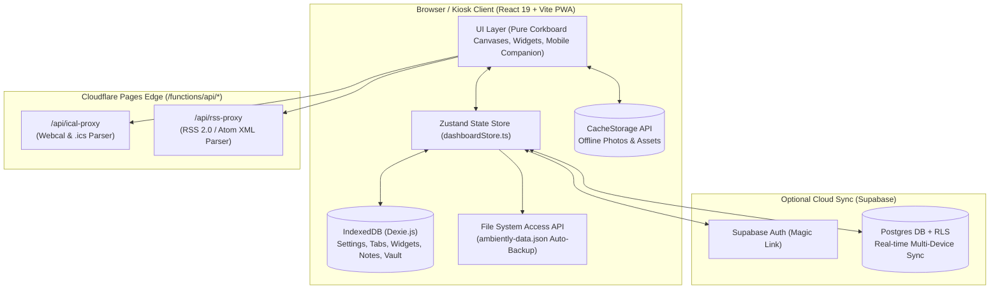

# Ambiently — System Architecture

## 1. High-Level Overview

Ambiently is engineered as a **Local-First Progressive Web App (PWA)** hosted on **Cloudflare Pages** (`dashboard.trinhism.com`). It is designed to boot in **0ms offline** with zero server dependency for core operations, while offering optional **Cloudflare Pages Functions** for CORS-free feed proxying and **Supabase** for multi-device cloud synchronization.

---

## 2. Local-First Data Layer (`src/services/db.ts`)

Ambiently uses **Dexie.js** over browser `IndexedDB` (`AmbientlyDB`) with 5 core object stores:
1. `settings`: Global kiosk configuration (`dockPosition`, `displayDensity`, `carouselEnabled`, `nightModeStyle`, `nightModeStart`, `nightModeEnd`, `wakeLockEnabled`, `pinHash`).
2. `tabs`: Ordered canvas definitions (`id`, `name`, `icon`, `order`, `autoRotateDurationSec`, `enabled`).
3. `widgets`: Widget instances scoped by `tabId`, storing normalized freeform canvas coordinates (`freeformPos: { xRatio, yRatio, wRatio, hRatio, zIndex, rotation, isFullScreen }`) and widget-specific `config` (e.g., calendar `.ics` sources, weather coordinates, custom photo arrays).
4. `notes`: Sticky notes & checklists scoped by `tabId`, supporting soft-deletion (`archivedAt`), automatic expiration (`expiresAt`), and freeform coordinates.
5. `localDeviceVault`: Device-only key-value store for sensitive local tokens that are never pushed to cloud sync.

---

## 3. Isolated Canvas Resolution Scaling (`src/App.tsx`)

To support 1080p tablets, 1440p monitors, and 4K TVs without causing "zoom traps" where settings buttons or navigation docks get clipped off-screen:
* The `transform: scale(displayDensity)` CSS transform is applied **exclusively to the inner `<Corkboard />` canvas container**.
* The `<NavigationDock />`, `<SettingsModal />`, and all configuration overlays remain pinned at the root `100%` viewport layer.

---

## 4. Serverless Edge Proxies (`functions/api/`)

Public calendar (`.ics`) and RSS feeds rarely include browser CORS headers (`Access-Control-Allow-Origin: *`). Ambiently solves this at the edge using Cloudflare Pages Functions:
* **`functions/api/ical-proxy.ts`**: Normalizes `webcal://` URLs to `https://`, fetches the raw `.ics` stream, parses `VEVENT` blocks (handling folded lines, `DTSTART`, `DTEND`, `SUMMARY`, `LOCATION`), and returns clean JSON cached at the edge for 15 minutes (`Cache-Control: s-maxage=900`).
* **`functions/api/rss-proxy.ts`**: Fetches RSS 2.0 `<item>` and Atom `<entry>` XML feeds, strips HTML/CDATA tags, and returns normalized JSON headlines cached for 15 minutes.
