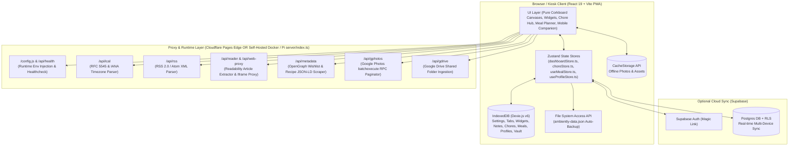

# Ambiently — System Architecture

## 1. High-Level Overview

Ambiently is engineered as a **Local-First Progressive Web App (PWA)** hosted on **Cloudflare Pages** (`dashboard.trinhism.com`) and packaged as a **standalone multi-architecture Docker & Raspberry Pi container** (`linux/amd64` + `linux/arm64`). It boots in **0ms offline** with zero server dependency for core operations, while running identical `/api/*` feed/media proxy handlers on either **Cloudflare Pages Functions** or the **bundled Node HTTP server (`server/index.ts`)**, plus optional **Supabase** multi-device cloud synchronization.

---

## 2. Local-First Data Layer (`src/services/db.ts`)

Ambiently uses **Dexie.js** over browser `IndexedDB` (`AmbientlyDB` schema version `6`) with 8 core object stores:
1. `settings`: Global kiosk configuration (`dockPosition`, `carouselEnabled`, `nightModeStyle`, `nightModeStart`, `nightModeEnd`, `wakeLockEnabled`, `pinHash`, `clockFormat`, `weekStartsOn`, `defaultWidgetStyle`, `photoAutoSyncIntervalHours`).
2. `tabs`: Ordered canvas definitions (`id`, `name`, `icon`, `order`, `autoRotateDurationSec`, `isHome`, `enabled`).
3. `widgets`: Widget instances scoped by `tabId`, storing normalized freeform canvas coordinates (`freeformPos: { xRatio, yRatio, wRatio, hRatio, zIndex, rotation, isFullScreen }`), mobile display ordering (`mobileOrder`), and widget-specific `config` (e.g., calendar `.ics` sources, weather coordinates, photo settings, quote intervals, chore widget scope, meal planner scope).
4. `notes`: Sticky notes, checklists, & shopping lists (`isShoppingList: true`) scoped by `tabId`, supporting soft-deletion (`archivedAt`), automatic expiration (`expiresAt`), canvas pinning status (`isPinnedToCanvas`), and freeform coordinates.
5. `localDeviceVault`: Device-only key-value store for sensitive local tokens and file handles that are never pushed to cloud sync.
6. `choreEngineState`: Singleton household snapshot (`id: 'household_chores'`) storing chore templates, active instances (across `pending`, `awaiting_approval`, `completed`, `skipped`, and `expired` lifecycle states), wishlist rewards, trophy case records, the immutable append-only point audit ledger, household chore settings, deletion tombstones (`deletedRewardIds`, `deletedTemplateIds`), and authoritative parent vs. self-service sync resolution (`mergeChoreSnapshotsAuthoritative`).
7. `householdProfiles`: Global family member profiles (`id`, `name`, `role`, `color`, `avatarDataUrl`, `icon`) shared across the Chore Engine and household planners.
8. `meals`: Singleton household meal planner snapshot (`id: 'household_meals'`) storing saved recipes (`recipes`), scheduled calendar meals (`scheduledMeals`, automatically pruned after 21 days in the past), checked grocery item keys (`checkedGroceryKeys`), and deletion tombstones for conflict-free cloud merging.

---

## 3. Responsive Proportional Canvas Architecture (`src/App.tsx`)

To support 1080p tablets, 1440p monitors, and 4K TVs cleanly:
* The canvas renders at crisp native 1:1 resolution (`w-full h-full`) without artificial CSS zoom scaling or rasterization blur.
* Widget positions and dimensions use normalized viewport ratios (`xRatio`, `yRatio`, `wRatio`, `hRatio`), ensuring perfect responsiveness across arbitrary aspect ratios while preventing edge clipping.
* The `<NavigationDock />`, `<SettingsModal />`, and all configuration overlays remain pinned at the root viewport layer with dismiss-on-backdrop and fixed sticky headers.

---

## 4. Serverless Edge Functions (`functions/api/`)

Cloudflare Pages Functions handle CORS-free feeds, media parsing, and deep pagination:
* **`functions/api/ical.ts` (`/api/ical`)**: Normalizes `webcal://` URLs to `https://`, fetches raw `.ics` streams, parses `VEVENT` blocks and `RRULE` recurrences via `ical.js` with fallback IANA timezone resolution (`Intl.DateTimeFormat`), and returns clean JSON cached at the edge for 15 minutes.
* **`functions/api/rss.ts` (`/api/rss`)**: Fetches RSS 2.0 `<item>` and Atom `<entry>` XML feeds, strips HTML/CDATA tags, extracts lead images and content snippets, and returns normalized JSON headlines cached for 15 minutes.
* **`functions/api/reader.ts` (`/api/reader`)**: Extracts clean, distraction-free article HTML, headlines, bylines, and hero images using `@mozilla/readability` and `linkedom` with semantic `<article>` and JSON-LD fallbacks.
* **`functions/api/web-proxy.ts` (`/api/web-proxy`)**: Proxies external web pages for in-app kiosk viewing when sites block direct iframe embedding via `X-Frame-Options` or `CSP frame-ancestors`.
* **`functions/api/metadata.ts` (`/api/metadata`)**: Extracts OpenGraph (`og:title`, `og:image`), product price metadata (`product:price:amount`, JSON-LD `Offer`) for the Chore & Reward Engine's Wishlist URL scraper, and Schema.org `Recipe` JSON-LD (`recipeIngredient`, `recipeInstructions` including `HowToStep`/`HowToSection`, `recipeYield`, and ISO 8601 `prepTime`/`cookTime`) for the Family Meal Planner's Recipe URL importer.
* **`functions/api/gphotos.ts` (`/api/gphotos`)**: Resolves public Google Photos shared albums (`photos.app.goo.gl` / `photos.google.com/share`). Extracts album metadata (`AF_initDataCallback 'ds:1'`) and automates subsequent `snAcKc` batchexecute RPC pagination to retrieve full photo collections (tested up to 7,500+ photos in ~11s, at most 10,000), kept in browser/edge cache for 1 hour unless `?rescan=1` bypasses caching (`Cache-Control: no-store`) during `photoSyncService.ts` scheduled background rescans or 15-minute cooldown-protected manual syncs.
* **`functions/api/gdrive.ts` (`/api/gdrive`)**: Resolves public Google Drive shared folders (`drive.google.com/drive/folders/...`) into high-resolution streamable photos (`=w1920-h1080`), skipping video/document formats, validating public access permissions, and supporting `?rescan=1` cache-bypass (`Cache-Control: no-store`) for scheduled/manual library rescans via `photoSyncService.ts`.
* **`functions/_shared/fetchExternal.ts`**: Every function fetches through this. It allows only public HTTPS addresses by default and checks each redirect too, caps the wait and the size of the answer, and refuses requests from other websites. Self-hosted Docker instances on private home networks can optionally set `AMBIENTLY_ALLOW_PRIVATE_FEEDS=true` to allow RFC1918 LAN / `.local` calendar and RSS feeds while keeping loopback (`127.0.0.1` / `localhost`) and cloud metadata (`169.254.169.254`) blocked. The photo functions always strictly require Google's HTTPS hosts.
* **`npm run dev`** runs these same functions through a small adapter in `vite.config.ts`, so development behaves like the deployed site.
* **Standalone Docker & Raspberry Pi Runtime (`server/index.ts`, `vite.server.config.ts`, `Dockerfile`, `compose.yaml`)**: Bundles `server/index.ts` and all 7 `functions/api/*` handlers into a single zero-dependency Node ESM bundle (`dist-server/index.mjs`) served alongside `dist/` in a non-root `node:22-alpine` (`linux/amd64` + `linux/arm64`) container, with runtime `/config.js` Supabase credential injection and `/api/health` readiness probes.

---

## 5. Mobile Companion Viewport Architecture (`MobileCompanion.tsx`)

To ensure flawless mobile touch interaction while preserving the kiosk corkboard's `overflow: hidden`:
* **Viewport Containment**: Mobile Companion renders inside a `fixed inset-0 w-full h-[100dvh]` container with `-webkit-overflow-scrolling: touch`, `touch-action: pan-y`, and `overscroll-behavior-y: contain`.
* **Independent Mobile Reordering**: Widgets retain an optional `mobileOrder` integer property. Swapping cards on mobile modifies `mobileOrder` without impacting desktop freeform coordinates (`xRatio`, `yRatio`).
* **Persistent View State**: View filter preferences (`all`, `widgets`, `notes`) are preserved in `localStorage` under `ambiently_companion_view`.

---

## 6. Self-Hosted Docker & Raspberry Pi Runtime Architecture

Ambiently supports 100% feature-parity self-hosting alongside its Cloudflare Pages deployment without duplicating backend logic:

* **Single-File Zero-Dependency Server Bundle (`server/index.ts`, `vite.server.config.ts`)**:
  * `npm run build:server` compiles `server/index.ts` and all 7 `functions/api/*` handlers (`noExternal: true`) into a single standalone ESM file (`dist-server/index.mjs`) using Node's native `node:http`, `node:fs`, `node:zlib`, and Web Fetch API (`Node 22`).
  * Incoming `/api/*` and `/functions/api/*` requests are converted into standard Web `Request` objects, passed directly into the exact same `onRequestGet` handlers used on Cloudflare Pages, and streamed back to the client.
* **Multi-Architecture Container & Asset Caching (`Dockerfile`, `compose.yaml`)**:
  * A multi-stage `node:22-alpine` build compiles `dist/` and `dist-server/index.mjs`, then copies only those two build outputs into a minimal non-root (`USER node`) runtime image supporting both `linux/amd64` and `linux/arm64` (Raspberry Pi 4/5).
  * Fingerprinted `/assets/*` bundles are served with `Cache-Control: public, max-age=31536000, immutable` and cached compressed (`gzip`) in memory, while `sw.js`, `version.json`, and `index.html` enforce `Cache-Control: no-cache` so updates propagate immediately.
  * Exposes `GET /api/health` (`{ status: "ok", version, uptimeSec }`) for Docker Compose `healthcheck` probes and kiosk boot synchronization.
* **Service-Worker-Safe Runtime Config Injection (`GET /config.js`, `src/services/supabase.ts`)**:
  * Because `vite-plugin-pwa` hashes `dist/index.html` into Workbox's precache manifest (`sw.js`), mutating `index.html` at container startup would conflict with cached Service Worker responses.
  * Instead, `index.html` loads `/config.js` (explicitly excluded from Workbox precaching and SPA navigation fallback in `vite.config.ts`). `server/index.ts` dynamically generates `window.__AMBIENTLY_CONFIG__` from runtime `SUPABASE_URL` / `SUPABASE_ANON_KEY` environment variables (`Cache-Control: no-store`), and `supabase.ts` caches the last known runtime config in `localStorage` so offline PWA reloads continue to initialize cleanly.
* **Raspberry Pi Kiosk & Standalone Appliance Lifecycle (`scripts/pi-kiosk-setup.sh`, [`RASPBERRY_PI.md`](./RASPBERRY_PI.md))**:
  * Supports both Raspberry Pi OS Bookworm Wayland (`labwc` / `wayfire` + `wlr-randr`) and X11 (`LXDE-pi` + `xrandr` + `unclutter`).
  * Can operate as a pure **Kiosk Display (`--mode kiosk`)** pointing at `https://dashboard.trinhism.com` or a LAN server, or as an **All-in-One Standalone Appliance (`--mode standalone`)** that runs the ARM64 Docker container locally (`restart: unless-stopped`), polls `http://localhost:8080/api/health` on boot before launching fullscreen Chromium, and clears Chromium crash flags after sudden power loss.
