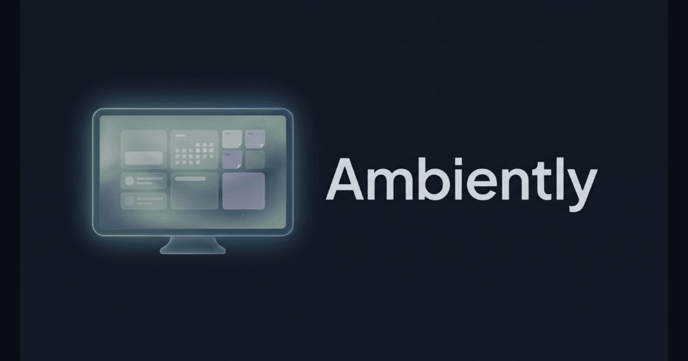

# Ambiently (`dashboard.trinhism.com`)

> Modern, ambient smart-display and command center Progressive Web App (PWA) under the Trinhism ecosystem, designed as a self-hosted, local-first alternative to commercial display services (Mango Display, DAKboard, Skylight).

[](LICENSE)
[](CHANGELOG.md)
[](https://github.com/Genghis1227/ambiently/actions/workflows/ci.yml)
[](https://github.com/Genghis1227/ambiently/pkgs/container/ambiently)



---

## 📚 Project Documentation

* **[Features & Capabilities Reference (FEATURES.md)](FEATURES.md)** — Comprehensive breakdown of widgets, multi-canvas corkboard architecture, chores, meal planning, photo frames, and mobile companion.
* **[Docker & Raspberry Pi Installation Guide (RASPBERRY_PI.md)](RASPBERRY_PI.md)** — Complete step-by-step installation manual for Docker Compose (`amd64`/`arm64`), Synology/Unraid/Portainer, and Raspberry Pi OS (Wayland / X11) fullscreen wall kiosks.
* **[System Architecture (ARCHITECTURE.md)](ARCHITECTURE.md)** — Local-first persistence engine, Cloudflare edge workers, standalone Docker runtime, resolution scaling, and Supabase cloud sync.
* **[Changelog (CHANGELOG.md)](CHANGELOG.md)** — Semantic version history and release notes.
* **[Developer Workflow (DEVELOPER_WORKFLOW.md)](DEVELOPER_WORKFLOW.md)** — Standard Trinhism contributor protocols and git branch sequence.

---

## 🌟 Highlights

* **⚡ 0ms Offline-First Boot:** Runs entirely out of client-side browser storage (IndexedDB via Dexie.js). Never shows a blank screen if home Wi-Fi drops.
* **🐳 1-Command Docker & 🍓 Raspberry Pi Edition:** Self-host the entire PWA and all 7 feed/scraper APIs in a ~55 MB multi-arch (`amd64` + `arm64`) container (`docker compose up -d`), or turn a Raspberry Pi 4/5 into an auto-booting wall display via [`scripts/pi-kiosk-setup.sh`](scripts/pi-kiosk-setup.sh).
* **💾 Local File Auto-Sync & JSON Snapshots:** Direct integration with the browser File System Access API to auto-save and mirror state directly to a local `ambiently-data.json` file, plus 1-click JSON export/restore.
* **📌 Pure Freeform Corkboard Multi-Canvas Engine:**
  * **Custom Canvases & Default Home Board:** Create up to 10 dedicated boards (e.g., *Family Board*, *Photo Gallery*, *Morning Briefing*) with 30 custom Lucide icons, 1-click tab reordering (`▲`/`▼`), and selectable default Home Board indicator.
  * **Compact Toolbar Horizontal Pop-Out Panels:** Keep all canvas buttons accessible even on smaller screens with horizontal pop-out bars for the **`+` Add Menu** (*New Note*, *Add Widget*, *New Canvas*), **Auto-Organize** (*Smart Bento Grid*, *Keep Sizes & Pack*, *Split Zones*), and **Quick Utilities** (*Night Mode*, *Fullscreen*, *Refresh/Update*, *Hide Toolbar*, *Quick Start Tour*).
  * **Interactive Freeform Pinboard:** Drag, tilt (`↺`/`↻`), layer (`z-index`), resize via bottom-right corner handles (`↘`), right-click blank canvas space to **Add Single Photo / GIF**, **New Sticky Note**, or **Add Widget Tile**, toggle frameless **Sticker / No Outline Mode** (per-widget or via the global **Default Widget Style** in Settings across compatible ambient, media, and text tiles), or expand any widget to **100% Fullscreen Canvas** with one click.
  * **Smart Pinned Notes (3 Formats):** Create **Text Notes**, **Checklists**, or dedicated **🛒 Shopping List** sticky notes (with automatic store-aisle grouping, inline `+ Add grocery item...`, and 1-tap `Clear (X)`), and pop floating notes onto the canvas with automatic collision avoidance.
* **🍽️ Family Meal Planner, Recipe Scraper, Smart Grocery List & Cooking Mode:**
  * **Flexible Calendar Scopes & Month Selector:** Switch between **Tomorrow**, **3-Day**, or **Full Week (7-Day)** views across Breakfast, Lunch, Dinner, and Snack slots, jump to any date via the interactive **Month Calendar Popover**, assign cooks in 1 tap from the **Household Profile Strip**, and keep storage lean with automatic 21-day history pruning.
  * **Quick-Meal Autocomplete & Recipe URL Scraper (`/api/metadata`):** Schedule meals in one tap using dynamic autocomplete chips from your recent history, or paste any recipe URL to automatically extract Schema.org `Recipe` JSON-LD ingredients, directions, prep/cook times, and hero photos.
  * **Distraction-Free Cooking Mode:** Tap any linked recipe to launch a high-contrast, step-by-step kitchen modal with interactive ingredient checkboxes, progress tracking, and automatic **Screen Wake Lock** so the display never dims while cooking.
  * **Smart Grocery Aggregator & Sticky Note Sync:** Automatically deduplicates and combines ingredient quantities across your active date window, sorts items by grocery store aisle, exports to **Google Keep**, or pushes directly into a **`🛒 Shopping List` Sticky Note** on your canvas.
* **🏆 Family Chore & Reward Engine + Global Household Profiles:**
  * **Global Household Profiles & HEIC/WebP Avatars:** Manage `Parent` and `Kid` profiles with client-side iOS 17/18 `.HEIC`/`.HEIF` photo decoding (`libheif-js`), an interactive circular zoom/pan/rotate cropper (`256×256` WebP), or custom keyboard emojis.
  * **Dual-View Kiosk Experience:** Add the compact Bento **Chores & Rewards** tile to any canvas and click its header **Maximize** button (or enable *Full-Screen Hub on Canvas* in Tile Settings) to open the 3-column **Full-Screen Chore & Reward Hub**.
  * **Flexible Cadences, Parent Auto-Completion & Shared Splits:** Schedule chores as *Daily*, *Weekdays*, *Weekends*, *Weekly — Any Day (1× / Week)*, *Weekly (Specific Days)*, *Interval (Every N Days)*, or *One-Off Bounty*. Assign to individual members or as a *Shared Pool* task with interactive integer point splitting (with parent completions automatically skipping the approval queue).
  * **Same-Day Chore Skip, 24-Hour Overdue Grace Window & Vacation Mode:** Skip same-day chores that don't apply (such as Homework) cleanly with a **Skipped • 0 pts** badge and same-day **Undo** without touching the ledger; unfinished chores roll over for 24 hours with configurable `100%`, `50%`, `0%`, or custom % overdue point policies and pause automatically during **Vacation Mode**.
  * **Append-Only Audit Ledger, Wishlist Store & Trophy Case:** Every point transaction is recorded in an immutable audit ledger. Kids can propose wishlist rewards (with automatic URL title/image/price scraping via `/api/metadata`), filter and edit/remove unpriced submissions in the **Proposals Tray**, parents price and approve redemptions behind a 4-digit PIN, and fulfilled prizes are archived into each child's **Trophy Case**.
* **📰 In-App Kiosk Reader Mode, Web Preview & 26 Curated RSS Feeds:**
  * **Distraction-Free Article Reader (`/api/reader`):** Powered by Mozilla Readability and Linkedom to extract clean article text, hero images, and tables without leaving kiosk mode, paired with an edge **Web Preview (`/api/web-proxy`)** fallback and a 26-feed curated directory across 6 categories.
* **📱 Mobile Companion Remote & Vertical Tile Stream:**
  * **Full Canvas Live Stream:** Seamless single-column vertical feed rendering live preview cards for all widgets (Clock, Weather, Countdown, Photos, RSS, Quotes, Media, Notes, Chores, Meal Planner) with independent mobile reordering (`▲` / `▼`) and `100dvh` momentum touch scrolling.
* **🖼️ Multi-Source Ambient Photo Frame & Scheduled Library Rescan:**
  * Stream slideshows in *Ken Burns*, *Mosaic Collage*, *Scattered Polaroids*, or *Filmstrip* styles from **Google Photos Shared Albums** (tested with 7,500+ photos), **Google Drive Shared Folders**, **Local / NAS Folders**, **Plex Media Server** (QR PIN auth), or **Curated Scenic Presets**, with automatic background library rescans (*Daily 24h* default, *Weekly 7d*, or *Manual Only*) and 15-minute cooldown-protected **Rescan Now** to pick up new uploads without spamming upstream servers.
* **📅 Multi-Calendar Feeds:** Unified chronological agenda & monthly grid parsing multiple `webcal://` and `.ics` feeds with per-calendar color tags, smart rate-limit protection, and a built-in US Holidays fallback.
* **🔒 Kiosk Security & Hardware Polish:**
  * Screen Wake Lock API, Fullscreen Mode, Scheduled Night Mode with pixel-shifting OLED clock, Kid-Proof 4-digit PIN lock (with email recovery when signed in), and Display Density scaling (`75%` to `150%`).

---

## 🛠️ Tech Stack

* **Frontend:** [React 19](https://react.dev/), [Vite](https://vitejs.dev/), [TypeScript](https://www.typescriptlang.org/)
* **PWA Engine:** `vite-plugin-pwa` (Workbox)
* **Styling & Animation:** [Tailwind CSS v4](https://tailwindcss.com/), [Framer Motion](https://www.framer.com/motion/), [Lucide React](https://lucide.dev/)
* **Local-First State:** [Dexie.js](https://dexie.org/) (IndexedDB) + [Zustand](https://github.com/pmndrs/zustand)
* **Media & Document Processing:** `libheif-js` (client-side iOS HEIC/HEIF decoding), `@mozilla/readability` + `linkedom` (article extraction), `ical.js` (RFC 5545 calendar recurrence & timezone parsing)
* **Serverless & Self-Hosted API Runtime:** Cloudflare Pages Functions (`/api/ical`, `/api/rss`, `/api/reader`, `/api/web-proxy`, `/api/metadata`, `/api/gphotos`, `/api/gdrive`) + standalone Node 22 HTTP server (`server/index.ts`) packaged as a multi-arch (`linux/amd64`, `linux/arm64`) Alpine Docker image.
* **Cloud Sync (Optional):** Supabase Auth & Realtime Postgres.

---

## 🚀 Installation & Getting Started

Choose whichever deployment option fits your setup:

### Option 1: Hosted Web App / Installable PWA (Zero Setup)
Open **[https://dashboard.trinhism.com](https://dashboard.trinhism.com)** on any tablet, iPad, smart display, or desktop browser and select **Install App / Add to Home Screen** for fullscreen offline-capable kiosk mode.

---

### Option 2: Docker & Docker Compose Self-Hosting (`amd64` & `arm64`)

Run the complete PWA and all 7 `/api/*` feed/scraper proxies locally on **Synology NAS, Unraid, TrueNAS, Portainer, Proxmox, Raspberry Pi, Linux, macOS, or Windows** using the pre-built multi-arch image (`ghcr.io/genghis1227/ambiently:latest`) or building from source:

```bash
# Quick 1-liner (pre-built linux/amd64 & linux/arm64 image from GHCR — no git clone needed)
docker run -d --name ambiently --restart unless-stopped -p 8080:8080 ghcr.io/genghis1227/ambiently:latest
```

**Or with Docker Compose (`.env` customizable):**
```bash
# 1. Clone the repository
git clone https://github.com/Genghis1227/ambiently.git
cd ambiently

# 2. (Optional) Configure port, timezone, Supabase sync, or private LAN feeds
cp .env.example .env

# 3. Pull & start the pre-built image (or pass --build to compile locally)
docker compose up -d

# 4. Verify healthcheck
curl http://localhost:8080/api/health
```

Open **`http://localhost:8080`** (or `http://<your-server-ip>:8080`).

* **Zero-Rebuild Configuration:** Set `SUPABASE_URL` & `SUPABASE_ANON_KEY` (for multi-device Realtime sync) or `AMBIENTLY_ALLOW_PRIVATE_FEEDS=true` (for local `192.168.x.x` / `.local` Nextcloud, Radicale, or Home Assistant `.ics`/RSS feeds) directly in `.env` or `compose.yaml`—no image rebuild needed.
* See **[RASPBERRY_PI.md — Part 2: Docker & Home Server Self-Hosting](RASPBERRY_PI.md#part-2-docker--home-server-self-hosting)** for Portainer/Synology stack templates and HTTPS reverse proxy examples.

---

### Option 3: Raspberry Pi Kiosk & All-in-One Wall Display

Turn a **Raspberry Pi 5** or **Raspberry Pi 4** running **Raspberry Pi OS (64-bit with Desktop)** into a dedicated wall-mounted family command center:

1. Flash **Raspberry Pi OS (64-bit) with Desktop** using [Raspberry Pi Imager](https://www.raspberrypi.com/software/) (enable Wi-Fi, SSH, and Desktop Auto-Login).
2. Run the automated setup script on the Pi (as your normal desktop user, not `root`):

```bash
git clone https://github.com/Genghis1227/ambiently.git ~/ambiently
cd ~/ambiently

# Interactive setup wizard (choose Kiosk Display Only OR All-in-One Local Docker Server + Kiosk)
bash scripts/pi-kiosk-setup.sh
```

**Non-Interactive CLI Shortcuts:**
```bash
# Mode A: All-in-One Standalone Pi (installs Docker ARM64, runs server on port 8080 + opens HDMI Kiosk)
bash scripts/pi-kiosk-setup.sh --mode standalone --port 8080

# Mode B: Kiosk Display Only (connects to hosted cloud or your home NAS Docker server)
bash scripts/pi-kiosk-setup.sh --mode kiosk --url https://dashboard.trinhism.com

# Portrait wall monitor (rotate 90, 180, or 270 degrees)
bash scripts/pi-kiosk-setup.sh --mode standalone --rotate 90
```

Reboot (`sudo reboot`) to launch directly into fullscreen Chromium Kiosk (supports Wayland `labwc`/`wayfire` and X11, disables OS blanking for OLED Night Mode, suppresses power-cut crash popups, and locks touchscreen pinch-zoom). Full guide in **[RASPBERRY_PI.md](RASPBERRY_PI.md)**.

---

### Option 4: Local Node.js Development & Production Server

**Prerequisites:** Node.js `20.x+` and npm `10.x+`.

```bash
# 1. Clone and install dependencies
git clone https://github.com/Genghis1227/ambiently.git
cd ambiently
npm install

# 2. Start Vite development server (with live /api/* function middleware) on http://localhost:5173
npm run dev

# 3. Or build and run the standalone production server on http://localhost:8080
npm run build
npm run build:server
npm start
```

---

## 💾 Local File PC Auto-Sync & Backup Architecture

Ambiently is built on an **offline-first local architecture**:

1. **Primary Browser Database (IndexedDB):** All widgets, canvases, sticky notes, checklists, chores, and meal plans are always saved instantly to IndexedDB (`AmbientlyDB`). The app never requires an internet connection or an external file to run and will never lose data across tab closures.
2. **Real-Time PC Auto-Sync (Chromium):** In Settings (`Backup & System`) or the Backup modal, click **PC Auto-Sync** to bind an `ambiently-data.json` file directly on your local computer's drive using the File System Access API.
   * **Reactive Event-Driven Snapshots:** Whenever you move widgets, check off to-do items, or edit canvases, Ambiently automatically streams snapshots to disk (with debounced safe-write queues preventing write lock collisions).
   * **Session Persistence & 1-Click Reconnect:** Ambiently stores the file handle securely inside IndexedDB. When reopening or reloading the app, Ambiently attempts silent permission verification (`queryPermission()`), or displays a 1-click **Reconnect Auto-Sync** button so you never have to re-browse your folder tree.
   * **Cloud Sync via Local Folders:** If you place `ambiently-data.json` inside a local **Dropbox, Google Drive, OneDrive, Nextcloud, or Synology Drive** folder, desktop sync clients will automatically detect updates and replicate your dashboard state across all your devices without routing data through third-party servers.
3. **Universal 1-Click Export & Restore:** For non-Chromium browsers (Safari, Firefox, iOS, Android), 1-click **Export Backup** and **Restore from File** provide complete standalone `.json` backup files that can be imported onto any device in seconds.

---

## ☁️ Cloud Sync Setup (Optional)

To enable real-time multi-device WebSocket sync across wall displays, tablets, and phones:

1. Create a free project at [supabase.com](https://supabase.com).
2. Run [`supabase/schema.sql`](supabase/schema.sql) and [`supabase/migrations/phase1_profiles_chores_meals.sql`](supabase/migrations/phase1_profiles_chores_meals.sql) in the Supabase SQL Editor, then run [`supabase/security-check.sql`](supabase/security-check.sql) (any returned row indicates a permission setting to review).
   * In **Authentication**, keep **Confirm email** and **Secure email change** on, and keep anonymous sign-ins off.
   * Never put the `service_role` key in the app—only use the publishable `anon` key.
3. Provide your project credentials depending on how you host Ambiently:
   * **Docker / Raspberry Pi (Runtime — No Rebuild Needed):** Set `SUPABASE_URL` and `SUPABASE_ANON_KEY` in `.env` or `compose.yaml` and run `docker compose up -d`.
   * **Cloudflare Pages / Static Hosting (Build-Time):** Set `VITE_SUPABASE_URL` and `VITE_SUPABASE_ANON_KEY` in **Settings -> Environment variables**.
4. In Ambiently (**Settings -> Backup & System**), sign in with your email code/magic link and click **Back Up to Cloud**.

---

## 📄 License & Self-Hosting Attribution (AGPLv3)

This project is licensed under the terms of the **GNU Affero General Public License v3.0 (AGPLv3)**. See the [LICENSE](LICENSE) file for full details.

### Self-Hosting & Attribution Policy
Ambiently keeps the live ambient display canvas 100% free of watermarks to prevent OLED burn-in and visual clutter. Instead, attribution and source links live unobtrusively inside the **Ambiently Quick Hub popover** (top-left logo menu) and the **Settings & Changelog modal footers** (`Powered by Ambiently • trinhism.com • Source (AGPLv3)`).

In accordance with **AGPLv3 Sections 7(b) and 13** (Remote Network Interaction & Preservation of Legal/Author Notices):
* If you self-host, fork, or deploy a modified version of Ambiently over a network, you **must preserve** the interactive attribution notices and source code links in the Quick Hub menu and Settings/Changelog modal footers.
* Any modified network deployment must also make its complete corresponding source code available under the AGPLv3.
